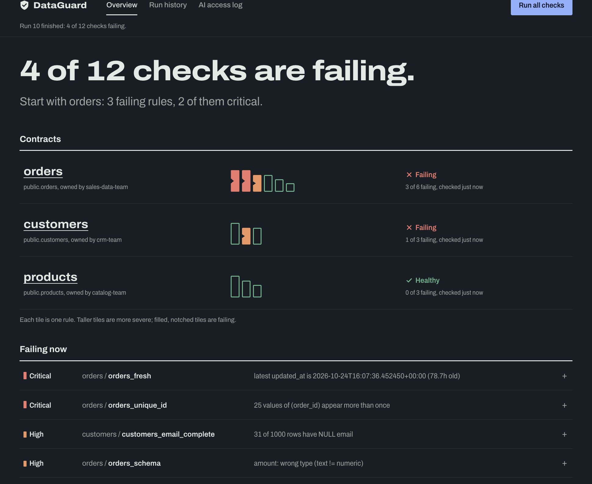
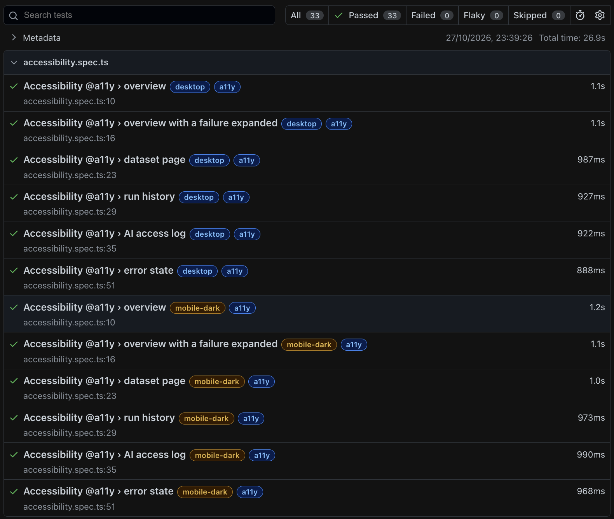
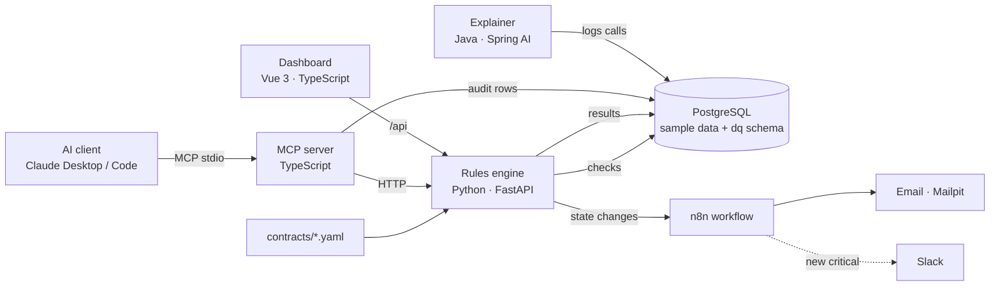

# DataGuard

[](https://github.com/najeemmd111-cpu/dataguard/actions/workflows/ci.yml)

Checks a PostgreSQL database against YAML **data contracts**, stores every result, and exposes failures to AI agents through an **MCP server** with role permissions and an audit log. A **Vue 3 dashboard** shows contract health, failing rules and every AI tool call.



<details>
<summary>Playwright report: 33 tests passing, including axe accessibility scans on desktop and mobile (dark mode)</summary>



</details>



## Status

| Phase | Scope | Status |
|---|---|---|
| 1 | Rules engine, data contracts, MCP server, tests, CI | ✅ built and tested |
| 2 | Vue 3 dashboard | ✅ built |
| 2 | Playwright end-to-end + axe accessibility tests, dashboard CI | ✅ 42 tests |
| 3A | Knowledge base, hybrid search (full-text + pgvector + re-ranking), retrieval evaluation | ✅ see `agent/` |
| 3B | Root-cause agent (tools, read-only SQL, structured answers), LLM usage logging, AI usage page | ✅ local model via Ollama |
| 4 | n8n alerts on state changes (email, optional Slack) | ✅ see `n8n/` |
| 4 | Spring AI explainer (Java 21, Spring Boot 3.5, structured output) | ✅ see `explainer-service/` |
| 5 | Kubernetes on kind: StatefulSet, Job, Deployments, probes, non-root, CI deploy + smoke test | ✅ see `k8s/` |
| 5 | Jenkins in Docker: Configuration as Code, pipeline job created automatically, JUnit reports | ✅ see `jenkins/` |

## Retrieval results

53 questions over the 20-page knowledge base. Hybrid search with cross-encoder re-ranking puts the right section first for **83%** of questions, against 58% for keyword search alone and 68% for vector search, at about 235 ms per question. Details: [agent/eval/results.md](agent/eval/results.md).

## Root-cause agent results

A local `qwen2.5:3b` model (Ollama) with tools (re-ranked doc search, rule history, read-only SQL) explains failures as schema-validated JSON. On the 4 seeded failures with a known cause, it went from **2 of 4 correct to 4 of 4** (identical in 3 runs) after prompt and tool fixes, while using 12% fewer tokens and 29% less time. Every model call is logged with tokens and latency. Details: [agent/README.md](agent/README.md).

## Explainer vs agent

The same failure explained two ways: the Spring AI explainer (one model call) took **638 tokens and 6.8 s**; the tool-using agent took about 8,800 tokens and 30 s but checks the data and cites the documentation. Details: [explainer-service/README.md](explainer-service/README.md).

## Quick start

Requirements: Docker Desktop, Node 20+ (for the MCP server and dashboard).

```bash
docker compose up --build          # Postgres + seed data + rules engine on :8000
curl -X POST localhost:8000/runs -H 'content-type: application/json' -d '{}'
curl localhost:8000/failures | jq
```

Open http://localhost:8000/docs for the API.

Then the dashboard:

```bash
cd dashboard && npm install && npm run dev   # http://localhost:5173
```

Then the MCP server:

```bash
cd mcp-server && npm install && npm run build
npm run inspect                    # try the tools in the MCP Inspector
```

…and connect it to Claude Desktop or Claude Code (see `mcp-server/README.md`).

Then the alerts (n8n and a fake inbox):

```bash
docker compose --profile alerts up -d
curl -X POST localhost:8000/alerts/test   # then read the email at http://localhost:8025
```

Or run the core on Kubernetes (kind) instead of Compose:

```bash
brew install kind kubectl
k8s/deploy.sh && k8s/smoke-test.sh        # dashboard on http://localhost:8880
```

Or run the CI pipeline in a local Jenkins:

```bash
docker compose --profile ci up -d --build  # http://localhost:8090 (admin / admin), job "dataguard"
```

Then the Spring AI explainer (Java, built inside Docker):

```bash
docker compose --profile explainer up -d --build
```

Then the knowledge search:

```bash
docker compose run --rm agent ingest      # index docs/ (downloads two small models once)
docker compose run --rm agent evaluate    # compare keyword, vector, hybrid and re-ranked search
```

Then the root-cause agent, with [Ollama](https://ollama.com) running and `ollama pull qwen2.5:3b` done once:

```bash
docker compose run --rm agent investigate orders_fresh
```

## What the sample data contains

`db/seed.py` creates 1,000 customers, 50 products and ~10,000 orders, with problems injected on purpose:

| Problem | Rule that catches it | Severity |
|---|---|---|
| `orders.updated_at` stopped 3 days ago | `orders_fresh` | critical |
| 25 duplicated `order_id` values | `orders_unique_id` | critical |
| `orders.amount` stored as `text` | `orders_schema` | high |
| ~4% of customers have no email | `customers_email_complete` | high |

`products` is clean, so it stays green. A full run gives **11 rules, 4 failing**.

## Repository layout

```
contracts/          YAML data contracts (one per dataset)
db/                 init.sql (all tables) + seed.py
rules-engine/       FastAPI: contract loader, checkers, runner, scheduler, API, pytest
mcp-server/         MCP server: 7 tools, permissions.json, audit log, vitest
docs/               knowledge base: 20 pages on rules, causes and runbooks (search corpus)
agent/              knowledge search (pgvector + full-text, RRF, re-ranking, evaluation) and the root-cause agent
dashboard/          Vue 3 + TypeScript: overview, dataset, run history, AI access log
e2e/                Playwright + axe: 42 end-to-end and accessibility tests
n8n/                alert workflow (webhook → email via Mailpit, Slack for new critical failures)
explainer-service/  Java Spring Boot + Spring AI: POST /explain → cause, impact, fix steps
k8s/                Kubernetes manifests, deploy.sh, smoke-test.sh (kind)
.github/workflows/  CI
jenkins/            Jenkins image with the toolchains, Configuration as Code (phase 5)
Jenkinsfile         the Jenkins pipeline: same checks as GitHub Actions, with JUnit reports
```

## Tests

```bash
cd rules-engine && pip install -r requirements-dev.txt -r ../db/requirements.txt && pytest   # 41 tests
cd mcp-server && npm test                                                                    # 7 tests
cd dashboard && npx vitest run                                                               # 12 tests
cd e2e && npm install && npx playwright install chromium && npm test                         # 42 tests
cd explainer-service && mvn verify                                                           # 10 tests (Java 21)
cd agent && pip install -r requirements-dev.txt && pytest                                     # 48 tests
```

The engine tests use Testcontainers (needs Docker) or `TEST_DATABASE_URL`. The end-to-end tests need the stack running (`docker compose up -d`); see `e2e/README.md`.

CI runs all six suites on every push, plus the retrieval evaluation with the real models (results in the `agent` job summary), and deploys the stack to a throwaway kind cluster for a smoke test. The Playwright HTML report is saved with each run (Actions → run → Artifacts).

## Design choices

- **Contracts are validated with Pydantic.** Unknown fields, bad identifiers, duplicate rule ids or an invalid `max_age` fail at load time with a clear message.
- **No string-built SQL.** Identifiers come from validated contracts and are still quoted with `psycopg.sql.Identifier`.
- **One failing check never breaks a run.** Each rule runs in its own transaction; errors are stored as failed results.
- **Runtime rules** added via the API or MCP live in `dq.custom_rules` and merge with the YAML (YAML wins on id clash).
- **Every MCP call is audited**, including denied calls and calls that error.
- **Alerts fire on state changes only** (a rule starts failing or recovers), never after every run, to avoid alert fatigue. A broken webhook never breaks a check run.

## What's next

All phases are done. A cloud deployment (for example Cloud Run) is left out on purpose: everything runs locally for free, on Docker Compose, kind and Jenkins.
