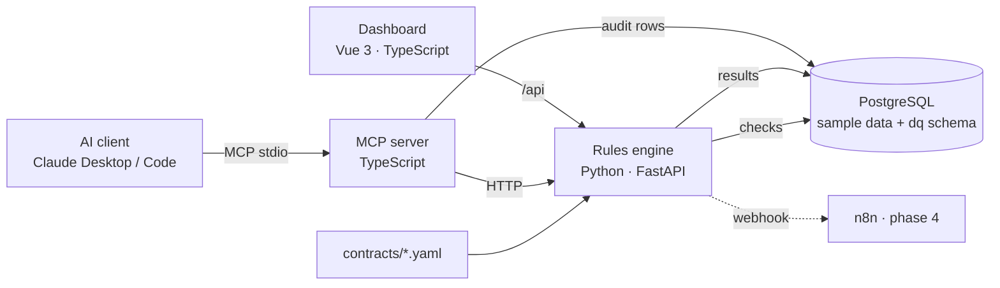

# DataGuard

[](https://github.com/najeemmd111-cpu/dataguard/actions/workflows/ci.yml)

Checks a PostgreSQL database against YAML **data contracts**, stores every result, and exposes failures to AI agents through an **MCP server** with role permissions and an audit log. A **Vue 3 dashboard** shows contract health, failing rules and every AI tool call.



## Status

| Phase | Scope | Status |
|---|---|---|
| 1 | Rules engine, data contracts, MCP server, tests, CI | ✅ built and tested |
| 2 | Vue 3 dashboard | ✅ built |
| 2 | Playwright end-to-end + axe accessibility tests, dashboard CI | ✅ 33 tests |
| 3 | Root-cause agent, hybrid RAG, evaluation, LLM cost log | ⬜ see `agent/`, `docs/` |
| 4 | n8n alerts, Spring AI explainer | ⬜ see `n8n/`, `explainer-service/` |
| 5 | Kubernetes (kind), Jenkins, Cloud Run | ⬜ see `k8s/`, `Jenkinsfile`, `deploy/gcp/` |

## Quick start

Requirements: Docker Desktop, Node 20+ (for the MCP server and dashboard).

```bash
docker compose up --build          # Postgres + seed data + rules engine on :8000
curl -X POST localhost:8000/runs -H 'content-type: application/json' -d '{}'
curl localhost:8000/failures | jq
```

Open http://localhost:8000/docs for the API.

Then the dashboard:

```bash
cd dashboard && npm install && npm run dev   # http://localhost:5173
```

Then the MCP server:

```bash
cd mcp-server && npm install && npm run build
npm run inspect                    # try the tools in the MCP Inspector
```

…and connect it to Claude Desktop or Claude Code (see `mcp-server/README.md`).

## What the sample data contains

`db/seed.py` creates 1,000 customers, 50 products and ~10,000 orders, with problems injected on purpose:

| Problem | Rule that catches it | Severity |
|---|---|---|
| `orders.updated_at` stopped 3 days ago | `orders_fresh` | critical |
| 25 duplicated `order_id` values | `orders_unique_id` | critical |
| `orders.amount` stored as `text` | `orders_schema` | high |
| ~4% of customers have no email | `customers_email_complete` | high |

`products` is clean, so it stays green. A full run gives **11 rules, 4 failing**.

## Repository layout

```
contracts/          YAML data contracts (one per dataset)
db/                 init.sql (all tables) + seed.py
rules-engine/       FastAPI: contract loader, checkers, runner, scheduler, API, pytest
mcp-server/         MCP server: 7 tools, permissions.json, audit log, vitest
docs/               rules documentation = RAG corpus (phase 3)
dashboard/          Vue 3 + TypeScript: overview, dataset, run history, AI access log
e2e/                Playwright + axe: 33 end-to-end and accessibility tests
agent/ explainer-service/ n8n/ k8s/ deploy/   later phases (READMEs with instructions)
.github/workflows/  CI
Jenkinsfile         same pipeline for Jenkins (phase 5)
```

## Tests

```bash
cd rules-engine && pip install -r requirements-dev.txt -r ../db/requirements.txt && pytest   # 30 tests
cd mcp-server && npm test                                                                    # 7 tests
cd dashboard && npx vitest run                                                               # 9 tests
cd e2e && npm install && npx playwright install chromium && npm test                         # 33 tests
```

The engine tests use Testcontainers (needs Docker) or `TEST_DATABASE_URL`. The end-to-end tests need the stack running (`docker compose up -d`); see `e2e/README.md`.

CI runs all four suites on every push. The Playwright HTML report is saved with each run (Actions → run → Artifacts).

## Design choices

- **Contracts are validated with Pydantic.** Unknown fields, bad identifiers, duplicate rule ids or an invalid `max_age` fail at load time with a clear message.
- **No string-built SQL.** Identifiers come from validated contracts and are still quoted with `psycopg.sql.Identifier`.
- **One failing check never breaks a run.** Each rule runs in its own transaction; errors are stored as failed results.
- **Runtime rules** added via the API or MCP live in `dq.custom_rules` and merge with the YAML (YAML wins on id clash).
- **Every MCP call is audited**, including denied calls and calls that error.

## What's next

See the phase READMEs. Next: the root-cause agent with hybrid retrieval and its evaluation (phase 3), which is the most distinctive part.
